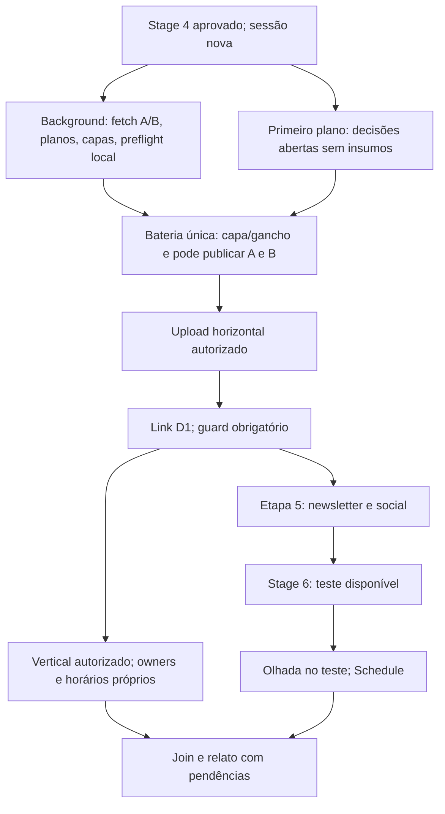

# Publica-video: diagnóstico e fluxo híbrido (#12622)

Levantamento em 10/11/2026, a partir do corpo e comentário OWNER da issue via REST API. Esta é a proposta de implementação, não uma autorização para executar o paralelo hoje. O fluxo serial de #12591 e a confirmação imediata de #11741 continuam vigentes até as filhas #12654 e #12655 entregarem os guards abaixo.

## Medição disponível

Últimas quatro edições com Stage 5 e 6 concluídos no checkout: 261104, 261105, 261106 e 261110. 261111 ainda está no Stage 4 e foi excluída. Fonte: `data/editions/2611/{edição}/_internal/stage-status.json`, campos `start`, `end`, `duration_ms`, `gate_at`, `pipeline_ms`. Tempos arredondados ao segundo; inclui espera e retrabalho.

| Edição | Stage 5 | Stage 6 | Stage 6 até gate | Gate até fim Stage 6 |
|---|---:|---:|---:|---:|
| 261104 | 10m54s | 6m58s | 14s | 6m45s |
| 261105 | 11m12s | 14m27s | 19s | 14m08s |
| 261106 | 9m19s | 35m21s | 1m56s | 33m25s |
| 261110 | 3h22m23s | 9m43s | 21s | 9m23s |

O intervalo após o gate inclui revisão humana, execução e fechamento: **não é medida pura de espera do editor**. Medianas: Stage 5 11m03s, Stage 6 12m05s. O outlier 261110 não deve virar estimativa de execução normal nem promessa de economia.

Reprodução somente leitura, sem recapturar custo nem modificar dados:

```python
import json
from pathlib import Path
from datetime import datetime
for edition in ["261104", "261105", "261106", "261110"]:
    doc = json.loads(Path(f"data/editions/2611/{edition}/_internal/stage-status.json").read_text())
    for row in doc["rows"]:
        if row["stage"] in [5, 6]:
            print(edition, row["stage"], row["start"], row["end"], row["duration_ms"])
            if row.get("gate_at"):
                dt = lambda value: datetime.fromisoformat(value.replace("Z", "+00:00"))
                print("até gate / após gate (s)", row.get("pipeline_ms", 0) / 1000,
                      (dt(row["end"]) - dt(row["gate_at"])).total_seconds())
```

`capture-stage-usage.ts` captura tokens/custo na janela start/end; não cronometra upload, Codex ou espera por si só. Os quatro registros usam `session_filter: current_session` nos Stages 5/6. 261106 tem `parse_errors: 5`: a duração de relógio permanece disponível, mas isso limita a confiança da captura de uso.

Inspeção complementar do `data/run-log.jsonl`: 3 linhas não JSON, ignoradas explicitamente na leitura; não há pares completos início/fim para capa/Codex, upload e espera nas quatro edições. Na 261106 há início de Stage 5 às 02:59:33.589Z e Stage 6 às 03:09:40.475Z, consent-off para YouTube (sem vídeo), e Schedule às 03:43:58.164Z. Ela é baseline das etapas, não do vídeo. Na 261110 o registro horizontal tem uploadedAt 06:03:22.909Z e rereadAt 06:03:31.806Z (8,897s entre esses eventos, não duração do upload); o Stage 5 começou às 02:55:10.467Z, antes desse registro, e o primeiro registro vertical é 06:35:11.036Z, depois do Stage 6. Não atribuir as 3h22 só a upload/capa ou ao código atual: a rodada cruza a mudança #12591. Registros de destino dos timers, horas depois, também não medem a duração da sessão.

**Resultado por fase:** Stage 5/6 medidos acima; download, dry-run, capa/Codex, espera humana, duração integral de upload e vertical guiado indisponíveis separadamente. Não subtrair timestamps de publicações para inventar esses tempos. #12655 inclui a instrumentação necessária para comparar o caminho crítico antes/depois.

## Dependências verificadas no código

- Social da Etapa 5 também depende do link: `publish-facebook.ts` e `publish-threads.ts` leem `readD1VideoUrlForPosts`; o playbook de `/diaria-5-publicacao` Passo 0b documenta também X. O gate `check-video-before-publish.ts` vale para **todos os escopos**, inclusive social. Não antecipar dispatch social nem Brevo. Preparar arquivos localmente é distinto de agendar posts.
- Horizontal: A1 e A2 produzem os insumos da confirmação. Capa do Drive/local dispensa geração quando previsto. Não perguntar aprovação de capa inexistente.
- Vertical: B1/B2 e preparação da capa podem começar cedo. `publish-shorts.ts` usa o título do registro horizontal ou o D1 como fallback (#12191). Fixar previamente o título aprovado; se o upload/fallback mudar metadados do vertical, o plano mudou e exige nova aprovação. Respeitar também vídeo relacionado e horários de #10831; não supor independência total A/B.
- Stage 6 depende do rascunho Kit e do teste. Escolher horário antecipadamente não aprova um e-mail ainda inexistente. Conservar a olhada no teste **antes** do Schedule (#8205); não introduzir um novo modo no-gates nem revisão após agendar.
- A3 já relê estado via API e grava o link mesmo com aviso de possível indisponibilidade (#12598), exceto falha/rejeição/deleção. A4 é fallback para link externo: `link-video-d1.ts` hoje lê registro local e aplica `gateVideoLink`, sem refrescar status remotamente. API oficial autenticada pode substituir a pergunta quando comprovar estado; sem credencial, timeout, privado ou resultado inconclusivo, manter o fallback humano. Pergunta preventiva não comprova estado futuro, e nunca autoriza `--assume-public` automaticamente.

## Fluxo proposto após as filhas



1. Iniciar tarefas reversíveis com `run_in_background`/worker **antes** de AskUserQuestion, que bloqueia o turno. Sem worker disponível, fazer preparação serial e declarar a limitação, sem fingir concorrência. Não executar publicação nem criar timers nesta fase.
2. Enquanto preparam, coletar apenas decisões realmente abertas sem insumos: horário excepcional do Schedule, overrides de plano. Reusar `--skip` e defaults existentes (#5321); não ressuscitar um menu obrigatório por canal. A resposta pode invalidar um dry-run já iniciado: regenerá-lo antes de mostrar.
3. Quando planos e capa estiverem prontos, mostrar uma bateria com escolhas independentes: capa/gancho e confirmação explícita de A e de B. Recusa de B não aprova B por associação com A. Confirmar capa nova muda o plano: congelar os bytes finais antes de autorizar upload. Silêncio não vale.
4. Executar A → link → guard → Stage 5/6, com B em paralelo a Stage 5/6 depois das dependências de metadados. A aprovação de B permanece válida só pelo protocolo da #12654. Mudança de plano ou interrupção exige revalidação e nova confirmação conforme #11741.
5. Única parada residual prevista no caminho normal: olhar o teste e autorizar Schedule. Falhas reais, ambiguidades de Drive ou guiados sem Chrome podem exigir intervenção adicional; a bateria inicial não elimina esses bloqueios. Chrome tem um único dono por vez (capa Shorts, Instagram e demais guiados); APIs e preparação local continuam em paralelo. Não oferecer a mesma conta/destino a dois owners.

## Guards e medição necessários

#12654 implementa manifesto canônico e SHA-256 junto da confirmação: edição/parte, hashes dos bytes de vídeo/capa/SRT, título/descrição, destinos, horários/fuso e owners/comandos. Publisher recalcula antes de efeito externo; diff exige nova confirmação. Timestamp volátil de dry-run pode ser excluído, conteúdo editorial não. Interrupção/rejeição continua invalidando autorização, consultando `video-publish-registry-status.ts` antes de retry; nenhum hash recupera um consentimento rejeitado. Até isso existir, não ampliar a validade da confirmação na skill.

#12655 implementa execução híbrida, refresh determinístico de A4 e eventos por fase com edição, tentativa, session/task-id, parte/stage, início/fim/erro e hash. Separar tempo ativo de espera (pergunta/resposta), upload de processamento e guiado de API. Ausência de evento é indisponível, não zero. Comparar caminho crítico por união dos intervalos, não soma de tarefas sobrepostas.

**Janelas de custo sobrepostas hoje contaminariam a atribuição:** `capture-stage-usage.ts` filtra por sessão e tempo; o vertical dentro da mesma sessão/janela de Stage 5/6 seria contado ali. Isolar transcript/sessão dos workers e provar a atribuição em fixtures antes de ativar paralelo; não usar `--all-sessions` para contornar. Custos das partes de vídeo ficam separados, sem inventar stage 7 (o capturador só rastreia 0–6). Stage 5/6 preservam start/end e `.step-5-done.json`/`.step-6-done.json`; nenhum sentinel é emitido por antecipação, e o join relata B pendente mesmo com 5/6 concluídos.

As filhas devem testar plano alterado/edição errada/sem confirmação, interrupção com processo sobrevivente, retomada com somente Stage 5 concluído, ausência de link em qualquer escopo, API inconclusiva, conflito de owners/Chrome e atribuição de custo em sobreposição. Sem publicação real ou gastos nos testes. #12588, #11741, #5578/#6171 e os sentinels permanecem invariantes. Aliases e `--so`/`--sem-publicacao` conservam seus limites.
